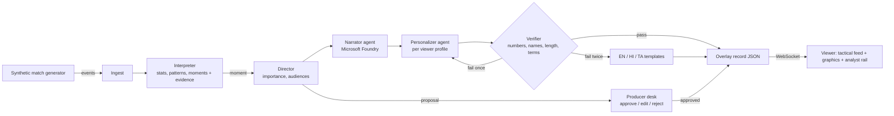

# Match Insights Studio

An AI insights engine on Azure that turns synthetic football events into explained, personalized, producer-approved broadcast overlays.

Built for the Microsoft and Premier League **Inside the Game: Developer Hackathon**, challenge *The Synthetic Match Insights Engine for Premier League Studio*. Target category: **Best Multi-Agent System**.

> All data is synthetic. Clubs, players and venues are invented. No real match data, footage or marks are used.

## The problem

Broadcast graphics report *what* happened, rarely *why*. The same overlay goes to a data analyst and to a first-time fan, usually in one language. And no broadcaster will let a model publish to air unchecked.

## What it does

One pipeline, five stages, running live as events arrive:

| Stage | What happens | Where |
|---|---|---|
| **Ingest** | A seeded simulator streams football-realistic events: passes, carries, dribbles, pressures, tackles, interceptions, shots with xG and speed, corners, cards, subs, sprints, per-minute physical load. | `backend/app/simulator.py` |
| **Interpret** | Live stats and patterns: xG, PPDA, press rate, pass difficulty, final-third entries, momentum (threat share), a control vs chaos index, speed and distance thresholds. Key moments are detected with the evidence that supports them. | `backend/app/interpreter.py` |
| **Goal analysis** | For every shot, the whole move is rebuilt from the event stream back to where it began (a regain, corner, free kick, kick-off or the keeper), and the patterns that created it are named: counterattacks, high regains, short passing sequences, set pieces, entries into the penalty area, half-space attacks, third-man runs, one-twos, switches of play, line-breaking passes, second balls and rebounds, numerical overloads (from an estimated freeze frame of all 22 players) and time and space for the finisher. Every sentence is written in EN/HI/TA and checked by the verifier. | `backend/app/buildup.py` |
| **Explain** | A **Narrator** agent explains why the moment matters, using only that evidence. A goal is linked to the tactical shift that caused it (for example, the press fading four minutes earlier). | `backend/app/agents.py` |
| **Render** | Timed, machine-readable overlay records (lower third, stat card, player tag, recap card) synced to the match clock, drawn over a live tactical feed. | `pipeline.overlay_record`, `frontend/` |
| **Personalize** | A **Personalizer** agent rewrites each overlay per viewer: Analyst, Casual fan or Player focus; favourite club; English, Hindi or Tamil. | `backend/app/agents.py`, `templates.py` |

Two controls make it safe for air:

- **Verifier** (code, not a model): every number and player name in an overlay must trace back to the moment's evidence; length limits and banned framing (betting language, real clubs or competitions) are enforced. A rejected draft goes back to the agent once with the exact problems; if it fails again, a deterministic template in the same language airs instead.
- **Producer desk**: the Director proposes overlays; a human approves, edits or rejects them, with an auto-air countdown and a full audit trail.

### The demo match (seed 21)

Northvale Rovers 2-1 Port Saltmere FC, with a storyline the engine has to find on its own:

- **19'** Reyes finishes a 13-pass move: *patient build-up*.
- **58'** Northvale's press fades: 29 pressing actions per 100 build-up passes against a match baseline of 47.
- **62'** Arata scores from 31 m at 118 km/h with 0.01 xG. The engine explains it as execution, not chance quality, *and* links it to the press fading four minutes earlier.
- **84'** Okonkwo wins the ball high and Reyes scores 4 seconds later: *counter-press regain*.

Final totals are football-realistic: about 700 and 600 passes at 79 to 82% accuracy, 15 and 21 shots, xG 1.6 and 2.2, PPDA around 11, players covering 10 to 12 km.

## Architecture



- **Agents**: Microsoft Agent Framework `Agent` objects backed by `FoundryChatClient` (Microsoft Foundry). Narrator, Personalizer and Recapper each have one job and a JSON contract. They hand off through the shared moment record. Model calls time out (default 12 s) and fall back so the broadcast never stalls.
- **Server**: FastAPI with WebSockets. One endpoint for viewers, one for the producer desk, REST for the overlay feed, audit trail and controls.
- **Hosting**: Azure Container Apps with a managed identity (keyless access to Foundry). Infrastructure in `infra/main.bicep`; one-command deploy in `scripts/deploy.sh`.
- **Built with GitHub Copilot**: `.github/copilot-instructions.md` encodes the pipeline rules.

## Overlay contract

Every overlay is a self-describing record a graphics partner can render without knowing anything about the match engine:

```json
{
  "id": "m-021|analyst|en|-|-",
  "moment_id": "m-021",
  "type": "goal",
  "slot": "lower_third",
  "t_in": 4166.4,
  "duration_s": 9,
  "clock": "61:42",
  "minute": "62'",
  "priority": 1.0,
  "team": "PSM",
  "players": ["PSM-8", "PSM-10"],
  "audiences": ["analyst", "casual", "player"],
  "headline": "Kenji Arata scores · 1-1",
  "body": "xG 0.01 · 118 km/h from 31 m · 3 passes in 10s. Why it matters: only 0.01 xG, so this was execution, not chance quality. Context: Northvale Rovers press had dropped to 29 from 47.",
  "source": "foundry",
  "verifier": [],
  "graphic": {"xg": 0.01, "shot_speed_kmh": 118, "distance_m": 31},
  "evidence": {"...": "every fact the copy is allowed to use"}
}
```

`GET /api/overlays?mode=casual&lang=ta&club=PSM` returns the whole feed for one profile.

## Run it locally

```bash
cd backend
pip install -r requirements.txt
python -m uvicorn app.server:app --reload --port 8000
```

- Viewer: http://localhost:8000/
- Producer desk: http://localhost:8000/producer
- Self-contained replay (no socket needed): http://localhost:8000/replay

Without Foundry settings it runs in **template mode**: the same pipeline, with deterministic copy in all three languages. To turn on the agents:

```bash
az login
export FOUNDRY_PROJECT_ENDPOINT="https://<resource>.services.ai.azure.com/api/projects/<project>"
export FOUNDRY_MODEL="gpt-5-mini"   # your model deployment name
```

Other settings are in `.env.example` (replay speed, auto-approve delay, seed).

### Generate a synthetic dataset

```bash
cd backend
python -m app.simulator --seed 21 --out ../data/match_21.jsonl          # storyline match
python -m app.simulator --seed 7 --script none --out ../data/match_7.jsonl  # pure model, goals from xG
```

## Deploy to Azure

```bash
export FOUNDRY_PROJECT_ENDPOINT=... FOUNDRY_MODEL=... FOUNDRY_RESOURCE_ID=...
./scripts/deploy.sh
```

This builds the image in the cloud, creates the Container App, assigns a managed identity, grants it **Azure AI User** on the Foundry resource, and pins one replica so the live match keeps running. The CI workflow in `.github/workflows/ci.yml` runs the tests, builds the replay page and, once Azure OIDC variables are set, redeploys on every push to `main`.

## Tests

```bash
cd backend && python -m pytest -q
```

Covers: deterministic generation, realistic match totals, story-moment detection (including the goal-to-press link), every template variant passing the verifier in all languages, the verifier catching invented numbers, names and banned terms, the agent repair loop and fallbacks, and live overlays over WebSockets.

## How it maps to the judging criteria

- **Technological implementation**: Foundry plus Agent Framework, a code verifier with a repair loop, deterministic synthetic data with realism tests, Container Apps with keyless auth, CI.
- **Agentic design and innovation**: distinct agents with narrow contracts, shared state through the moment record, a verifier handoff that recovers from failures, and a human producer in the loop.
- **Real-world impact**: explainable overlays a studio can trust; one feed serving analysts, casual fans and regional audiences.
- **UX and presentation**: a tactical feed with broadcast graphics, a "Why?" drawer that shows the evidence behind every overlay, and instant switching between modes and languages.
- **Category adherence**: Best Multi-Agent System. Distinct roles, shared state, handoffs, failure recovery, and an end-to-end outcome no single agent produces.

## Responsible AI and data

- Synthetic data only; invented clubs and players; no real marks.
- Agents cannot publish anything the verifier cannot trace to evidence.
- A human can stop, edit or reject any overlay; every decision is logged.

## Licence

MIT. Third-party: FastAPI (MIT), Uvicorn (BSD), Microsoft Agent Framework (MIT), Azure Identity (MIT). Fonts from Google Fonts (OFL).
